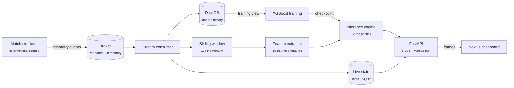

# ApexPulse

**Real-time CS2 telemetry and a live win-probability engine.**

ApexPulse ingests Counter-Strike 2 match telemetry as a stream, turns each tick
into a feature vector, scores a gradient-boosted win-probability model in about
two milliseconds, and pushes the result to a live dashboard over WebSockets.

```
4v3 live        CT  77.4%  ###############
bomb planted    CT  69.5%  ##############     ← the win condition flips
3v3 post-plant  CT  63.2%  #############      ← CT loses a player
```

*Real output from the running system: the probability moving as a round unfolds.*

---

## Architecture



Every stage is written against an interface, not a client. The broker and the
state store each have an in-process implementation and a production one
(Redpanda, Redis), chosen by configuration — so the whole pipeline runs on a bare
laptop with no services, and the same code runs against the real stack unchanged.

| Layer | Technology |
| --- | --- |
| Transport | Redpanda (Kafka API), or an in-process broker |
| Live state | Redis, or SQLite |
| History & training data | DuckDB, Parquet export |
| Model | XGBoost, `binary:logistic` |
| API | FastAPI, WebSockets |
| Dashboard | Next.js 15, React 19, Tailwind 4 |
| Tooling | uv, ruff, mypy (strict), pytest, ESLint, GitHub Actions, Docker Compose |

---

## Results

Measured on 280,482 labelled ticks from 40 simulated matches. Evaluation always
holds out **whole matches**: consecutive ticks in a round are nearly identical,
so a row-wise split would leak the answer and inflate every number below.

| Metric | Value |
| --- | --- |
| ROC AUC | **0.709** |
| Skill over always guessing the base rate | **+11.0%** |
| Accuracy | 64.8% (base rate 50.3%) |
| Log loss | 0.6165 (baseline 0.6931) |
| Inference latency | p50 1.59 ms · p99 2.96 ms — budget 20 ms |

### The headline number hides a fifty-point spread

The single skill score says the model works on average. Sliced by situation, it
says where:

| Situation | Ticks | AUC | Skill |
| --- | ---: | ---: | ---: |
| Lopsided (3+ player gap) | 4,689 | 0.900 | **+49.5%** |
| Clutch (a side down to one) | 6,653 | 0.858 | **+31.1%** |
| Late round | 3,532 | 0.879 | +24.6% |
| Post-plant | 12,588 | 0.630 | +1.9% |
| **Even manpower** | 18,752 | 0.579 | **−0.8%** |

The model is sharpest exactly when viewers are watching — clutches and decided
rounds — and **adds nothing at even manpower**. That is an honest result, not a
bug: with equal players, the remaining features genuinely do not determine the
round in this simulator. `apexpulse validate` reproduces this table.

### What the model learned

Nobody told it that manpower decides CS2 rounds. `alive_delta` alone carries
**33.0%** of the model's gain, and the manpower features together dominate —
learned from 225,214 training ticks.

---

## Quickstart

Requires [uv](https://docs.astral.sh/uv/) and Python 3.12. No services needed.

```bash
uv sync --all-extras

uv run apexpulse simulate --seed 7      # play a match, print the scoreline
uv run apexpulse dataset --matches 40   # generate labelled training data
uv run apexpulse train                  # train and report held-out metrics
uv run apexpulse validate               # benchmark by situation, check drift
uv run apexpulse serve --simulate       # API with a live match on :8000
```

Then, in a second terminal:

```bash
cd frontend
npm ci
npm run dev                             # dashboard on :3000
```

Open **http://localhost:3000**, or **http://localhost:8000/docs** for the
interactive API.

### Full stack with Docker

```bash
uv run apexpulse dataset --matches 40 && uv run apexpulse train   # checkpoint first
docker compose up --build
```

Runs Redpanda, Redis, the API on its real backends, the dashboard, and the
Redpanda console on :8080. Checkpoints are mounted read-only rather than baked
into the image; without one the API still serves live state and says so on
`/health`.

---

## API

| Endpoint | Returns |
| --- | --- |
| `GET /matches` | Every live match with its current probability |
| `GET /matches/{id}` | Full snapshot: score, round, players, economy, momentum |
| `GET /matches/{id}/history` | Completed rounds and the current streak |
| `GET /matches/{id}/prediction` | The probability **and the 15 features behind it**, by importance |
| `GET /model` | Checkpoint metadata and held-out metrics |
| `GET /health` · `/ready` · `/metrics` | Dependencies, readiness, latency percentiles |
| `WS /ws/{id}` · `WS /ws` | Live frames for one match, or all of them |

`/health` and `/ready` deliberately disagree when no model is loaded: the
service is degraded but still able to serve live state, and an orchestrator
needs to tell those apart.

---

## Design notes

A few decisions that are easy to get wrong, and what drove them.

**Calibration ships off — because measuring said so.** The first checkpoint
looked overconfident, so isotonic calibration was the obvious fix. With the
reporting matches held out from both the model and the calibrator, it made
things worse: calibration error went from 3.58% to 11.3%. `binary:logistic`
already optimises log loss, so the raw model was calibrated. The code stays
behind `--calibrate` for a model that needs it.

**One feature path, tested twice.** Features are computed per tick when serving
and vectorised over 280k rows when training. The arithmetic therefore exists in
two places, and a parity test asserts they agree exactly — because a feature
computed one way in training and another in production is the classic way a
model benchmarks well and fails live.

**Momentum was silently dead, once.** Windowed momentum was originally dropped
when ticks were persisted, so two of fifteen features were constant zero in
training while the live model received real values. Persisting the window
turned `kill_delta_window` from inert into the fifth-strongest feature.

**Drift detection knows when it cannot tell.** A per-match feature such as the
scoreline repeats one value across thousands of ticks, so its effective sample
size is the match count. PSI over four matches reads that as drift when nothing
has moved. The detector separates a thinly-sampled feature (unknowable,
excluded from the verdict) from one that has collapsed to a constant (a definite
upstream failure, always flagged).

**A null probability is not 50%.** Freezetime and a missing model mean the model
has no opinion. The dashboard shows "waiting for a scoreable tick" rather than
drawing an even split the model never made.

---

## Limitations

- **The data is simulated.** The model learned this simulator's rules, not
  professional CS2. The pipeline, features, and evaluation are production-shaped;
  the +11.0% skill measures fidelity to the generator, and real demo files would
  be the next step.
- **No skill at even manpower**, as above. Better features for that state — utility
  remaining, positioning, site control — would be where to start.
- **The container images are built in CI, not locally.** The development machine
  could not run Docker; the Dockerfiles are exercised by the `images` CI job.

---

## Development

```bash
uv run pytest            # 425 tests
uv run ruff check .      # lint
uv run mypy              # strict type-checking
make check               # all three
```

```bash
cd frontend
npm run lint && npm run typecheck && npm run build
```

CI runs four jobs on every push: backend gates, frontend gates, an end-to-end
pipeline that simulates, replays, trains, and validates, and an image build.

## Layout

```
src/apexpulse/
├── schemas/     domain models; CS2 rules enforced as validators
├── producer/    match simulator and replay publisher
├── broker/      transport interface: in-memory | kafka
├── stream/      consumer, sliding window, live-state tracker
├── storage/     state stores, state manager, DuckDB training sink
├── features/    online extractor and its offline twin
├── ml/          training, calibration, confidence, drift, benchmarks
├── inference/   low-latency engine and publishing worker
└── api/         FastAPI routes, WebSocket manager, broadcaster
frontend/src/    Next.js dashboard, typed against the API contract
```

## License

MIT © George Kitsakis
